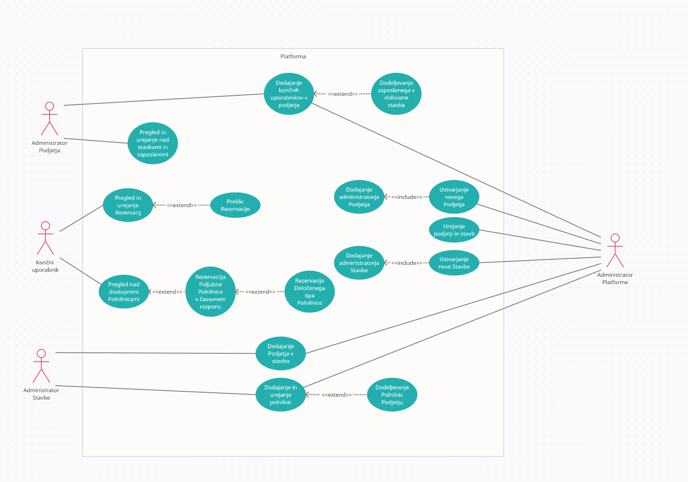
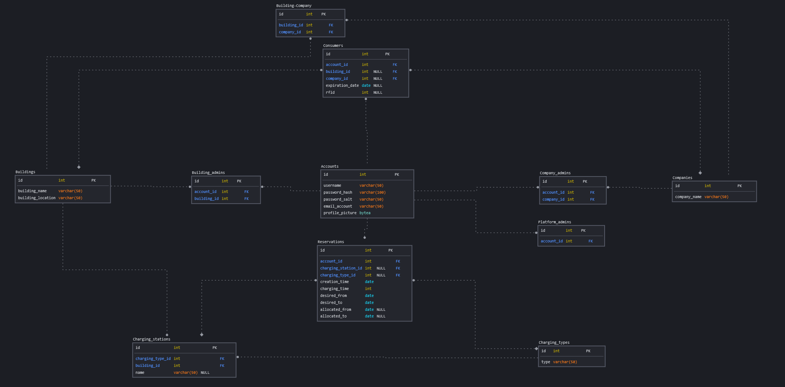

# EV Charge Platform

Platforma za rezervacijo električnih polnilnic za poslovne stavbe. 
Omogoča urejanje in bolj organizirano uporabljanje električnih polnilnic za bodisi službene avtomobile, osebne avtomobile zaposlenih ali kakih gostov.

Osnovna dejavnost platforma je upravljanje rezervacij končih uporabnikov na neke polnilnice.

Osnovni potek je vezan na administratorje.

V nadaljevanju so pomembne definicije, ki gradijo celotno platformo.

# KONCEPTUALNI NIVO

### Polnilnica
Polnilnica je lahko navadna ali pametna (vsebuje protokole za komunikacijo).
Polnilnice pripadajo neki stavbi/zgradbi.
Polnilnice lahko uporabljajo vsi, ki so registrirani v stavbi, razen če polnilnice pripadajo določenemu podjetju v teji stavbi - te lahko uporabljajo le zaposleni tega podjetja.

Polnilnica ima konektorje, kateri se dejansko priklopijo v avtomobil in polnijo.
Polnilnica ima lahko enega ali več konektorjev.

### Podjetje
Podjetje ima (enega ali več) administratorja podjetja, ki dodaja (in ureja) svoje zaposlene kot končne uporabnike platforme.
Če podjetje posluje v več stavbah, je administratorju omogočeno dodeljevanje zaposlenega v določene stavbe podjetja - ali pa pusti prosto, kar pomeni da nek zaposlen v podjetju lahko uporablja vse polnilnice vseh stavb podjetja.

Podjetje ima lahko svojo stavbo ali pa najema. 
V tem smislu se razlikuje le "vloga za platformo". 
Če ima podjetje svojo stavbo, bo imelo svojega Administratorja podjetja in bo lahko urejalo svoje polnilnice. 
Več o administratorjih kasneje.

### Stavba
Stavba je objekt, na katero so vezane polnilnice. 
V stavbi je lahko eno ali več podjetij. 
Stavba ima (enega ali več) Administratorja stavbe, kateri lahko doda podjetje v stavbo (tako omogoči novemu podjetju uporabo polnilnic).
Predvsem pa dodaja in ureja polnilnice. 
Polnilnice so lahko v skupno uporabo, ali pa pripadajo določenemu podjetju v stavbi.

 
To so bile osnovni izrazi, ki se uporabljajo.

## ADMINISTRATORJI

Diagram primerov uporabe za okviren visokonivojski načrt.

### Administrator Platforme
Plaftorm admin bo nek zaposlen v tem podjetju (EV charge)(TBD), kateri služi kot avtentikator in vrhovni administrator. 
Ko želi podjetje uporabljati platformo, pošlje vlogo in Admin platforme ustvari novo podjetje v bazi ter temu podjetju dodeli Admina podjetja.

Admin platforme tudi doda stavbo (tudi prek vloge) v bazo ter dodeli Administratorja stavbe.

Dejanski primeri uporabe:
1) Ustvarjanje podjetja
>V bazo se doda to podjetje. Spisek podjetij se sklicuje na to.
>> Npr. ko se dodaja podjetje v stavbo
2) Dodajanje administratorja podjetja
> Zapiše se kdo so admini ter se tem uporabnikom dodeli pravice.
3) Ustvarjanje stavbe
> V bazo se doda stavbo. Na to se sklicuje spisek stavb.
4) Dodajanje administratorja stavbe
> Zapiše se kdo so admini ter se tem uporabnikom dodeli pravice
5) Splošno urejanje
> Admin platforme lahko pregleduje, dodaja/ureja/briše vse stavbe, podjetja in končne uporabnike.

### Administrator Stavbe
Administrator stavbe skrbi za polnilnice in podjetja v stavbi. 
Če je podjetje lastnik stavbe, je Admin stavbe po navadi kar Admin podjetja.

Primeri uporabe:
1) Dodajanje podjetja v stavbo
> Podjetje logično posluje v teji stavbi in lahko uporablja polnilnice.
2) Dodajanje in urejanje polnilnic.
> Če stavba dobi nove polnilnice (ali izgubi kakšne), lahko Admin stavbe to uredi.
>> Ob prvem ustvarjanju stavbe se lahko že tam pove, koliko polnilnic ima, za to pa poskrbi Admin platforme.
3) Dodeljevanje polnilnic podjetju
> Če so neke polnilnice od podjetja, se lahko to zabeleži, te polnilnice bodo nato na voljo le zaposlenim tega podjetja.
Če so polnilnice proste (od stavbe), bodo na voljo vsem uporabnikom v stavbi.

### Administrator Podjetja
Admin podjetja vpisuje svoje zaposlene kot končne uporabnike, tako jim omogoči uporabo platforme.

Primeri uporabe:
1) Dodajanje končnih uporabnikov v podjetje
> Zaposleni lahko sedaj uporablja platformo. Podrobnejša razlaga "dodajanja končnega uporabnika" bo v drugem dokumentu.
2) Dodeljevanje zaposlenega v določene stavbe
> Če podjetje posluje v več stavbah, lahko Admin podjetja ureja zaposlene, da dostopajo le do določenih polnilnic stavb. Drugače lahko zaposlen uporablja vse polnilnice v vseh stavbah tega podjetja.

## VLOGA
To je nekak visok okviren potek k pristopu uporabe te platforme.
>Ko podjetje želi uporabljati platformo, odda vlogo (ali pa kako drugače, pomembna je avtentikacija). Admin platforme registrira podjetje in ustvari Admina podjetja (ter dodeli).

>Če ima podjetje svojo stavbo, lahko ob vlogi tudi poda vlogo za stavbo, kjer bo Admin platforme poleg podjetja dodal tudi stavbo ter ustvaril Admina stavbe (ter dodeli). Ob ustvarjanju stavbe se lahko že pove število polnilnic, ali pa jih Admin stavbe naknadno doda.

## KONČNI UPORABNIK
Končni uporabnik lahko uporablja platformo za rezerviranje njemu dostopnih polnilnic.
Končni uporabnik bo zaposlen v nekem podjetju.

Ker je sistem rezervacij kompleksen, ima rezervacija svoje poglavje.

Primeri uporabe:
1) Pregled nad dostopnimi polnilnicami
> Končni uporabnik ima pregled nad polnilnicami, ki so njemu dostopne. To pomeni polnilnice v stavbah, kjer podjetje posluje, ali pa kakšne prosto dostopne polnilnice.
>>Tu lahko tudi vidi koliko uporabnikov trenutno čaka na neke polnilnice
2) Rezervacija poljubne polnilnice v časovnem razponu
> Ko uporabnik želi polniti, lahko izbere nek časovni razpon in se rezervira. Načeloma se rezervira na vse polnilnice v neki stavbi (vendar mu je dodeljena ena določena). 
>>Izbere lahko časovni razpon, tu lahko nemudoma dobi rezervacijo, če je neka polnilnica prosta, ali pa se postavi v vrsto ter dobi obvestila, če se polnilnice sprostijo.
3) Rezervacija določenega tipa polnilnice
> Podobno kot prejšni primer, vendar tu je omogočena rezervacija na točno določen tip polnilnice.
>>Npr. uporabnik potrebuje super hitro polnilnico, ali pa avto podpira točno določen konektor
4) Pregled in urejanje rezervacij
> Uporabnik lahko pregleduje svoje rezervacije ter jih ureja. Tu se lahko zgodi, da izgubi rezervacijo (če npr. spremeni tip polnilnice na nek drugi, itd...).
>> Spreminja časovni razpon, spreminja tip, ...
6) Preklic rezervacije
> Uporabnik prekliče rezervacijo, s tem se odstrani iz vrste  in se vrsta popravi (drugi dobijo obvestila)

## REZERVACIJA
Rezervacija je jedro platforme.
Rezervacije so mišljene malo bolj dolgoročno, torej je smiselno rezervirati polnilnico vsaj en dan prej, če ne še prej.

Rezervacija na isti dan je mogoča, vendar kompleksnejša glede čakalnih vrst.
Čakalne vrste so predvidene kot željena rezervacija za tisti dan, če pa kdorkoli prekliče rezervacijo, se po čakalni vrsti izbira naslednjega.

Ko končni uporabnik želi uporabljati polnilnice, bo na platformi izbral željeni čas polnjenja.
Ta bo omejen z obeh strani.
> Trenutno se govori za minimum 30 minut in maksimum 3 ure.

Poleg tega si lahko tudi izbere, ali želi polniti neprekinjeno ali pa dovoli polnjenje v kosih.
> Če uporabnik izbere neprekinjeno polnjenje, bo morda dosti težje dobiti rezervacijo, če so polnilnice zasedene in bo čakalni vrsti.

Nato bo še izbral dostopni čas, torej od kdaj do kdaj je na voljo in želi polniti.
> Če so polnilnice proste, mu bo ena dodeljena, drugače se postavi v čakalno vrsto. Če nekdo drug prekine rezervacijo ali nekdo zaključi prej, se čakalna vrsta premakne.

Uporabnik lahko tudi poleg rezervacije ure (zgoraj omenjeno) izbere tudi tip polnilnice (konektorja), nakar bo logika platforme poskrbela, da dobi izbran tip.
Če ima uporabnik izbrane 3 ure in dobi 2 uri, je še vedno 1 ura v rezervaciji.

# TEHNIČNI NIVO
Tehnični nivo vsebuje tehnične detajle in izraze, zato bo jezik bolj tehnični (ne književni).

ER diagram, trenutna verzija (morda se spremeni, oz. *dopolni* ).
Baza bo PostgreSQL.

Nekaj o rezervacijah:
Tehnično je implentirana kot tabela v bazi, katera se filtrira in sortira, tako se obnaša kot vrsta.
Sortira se po `creation_time`. Pogojuje se po `allocated_from`, `allocated_to`, `charging_time`, po tem se loči rezervacije, ki so že v izvajanju ali ne.

Link do začasne baze: [NeonDB](https://console.neon.tech/app/projects) (personal)

Še kaj o podatkovni bazi?

 

# API
Base URL: domain.com/api/v1 (swagger)

Endpointi sledijo principu: api/version/group/method/methodName

V oklepajih so parametri, vprašaj pomeni "nullable", torej optional parameter. Pri vseh pride zraven še sessionID. 

Vsakič, ko se izvede klic na endpoint, se v backendu najprej izvede *confirmation* funkcija, ki primerja podan sessionID, torej če je potekel (če ni, ga osveži) in če ima dovoljene pravice za to akcijo (role). Če confirmation vrne *true* se nadaljuje koda, torej klic na dejansko funkcijo, drugače vrne response *401 unathorized*.

Pri vsaki je treba še jasno definirati, kdo lahko dostopa do te metode - katere role so avtorizirane!

Nekaj funkcij, ki samo pregledujejo stvari (npr. pregled polnilnic) je dovoljeno za profile, ki še niso validirani. Za ostale funkcije (npr. narediti rezervacijo) pa mora biti profil validiran.

Grupe:

 

## AUTH: /api/v1/auth
Metode namenjene avtentikaciji in avtorizaciji. Potrebno je še bolj naštudirati oath 2.0 ali pa lepo dodelati naš prvotni plan.

`/api/v1/auth/login` 
Uporabnik se prijavi, ob tem poda svoje uporabniško ime in geslo, če je uspešno, dobi nazaj generiran sessionID.

`/api/v1/auth/register/step1` 
Uporabnik se registrira tako, da poda svoj email in geslo. Registracijo mora še potrditi.

`/api/v1/auth/register/step2` 
Registracija se potrdi v drugem koraku, ko uporabnik "pride" na ta url, poslan prek maila.

`/api/v1/auth/logout` 
Uporabnik se odjavi, pri tem se zbriše sessionID.

 

## USER: /api/v1/user
Metode namenjene urejanju uporabnikov. *Ustvari se nov nekaj* pomeni le, da se obstoječemu profilu - ki je vedno že registriran po navadnem načinu (auth/register) - doda te pravice.

`/api/v1/user/post/assignBadmin (userID, buildingID)` 
Ustvari se nov admin stavbe

`/api/v1/user/post/assignCadmin (userID, companyID)` 
Ustvari se nov admin podjetja

`/api/v1/user/post/assignCompany (userID, companyID)` 
 Ustvari zaposlenega

`/api/v1/user/post/assignBuilding (userID, buildingID)` 
Zaposlenega se doda v neko stavbo, v kateri operira podjetje

`/api/v1/user/get/buildingAdmins` 
Vsi admini stavb

`/api/v1/user/get/companyAdmins` 
Vsi admin podjetij

`/api/v1/user/get/assignedBadmins (buildingID)` 
Vsi admini stavb določene stavbe

`/api/v1/user/get/assignedCadmins (companyID)` 
Vsi admini podjetij določenega podjetja

`/api/v1/user/delete/account (userID)`
Izbris uporabnika iz vseh tabel v sistemu.

`/api/v1/user/delete/building_access (userID, buildingID)`
Odstranitev dostopa uporabnika do neke stavbe

`/api/v1/user/delete/employee (userID, companyID?, buildingID?)` 
Izbris uporabnika, največkrat zaposlenega (če podan companyID), lahko tudi le izbris zaposlenega iz neke stavbe od podjetja, lahko splošen izbris uporabnika

`/api/v1/user/delete/badmin (userID)` 
Odstranitev profila admina stavbe

`/api/v1/user/delete/cadmin (userID)` 
Odstranitev profila admina Podjetja

`/api/v1/user/patch/editProfile (userID)` 
Urejanje svojega profila - navaden uporabnik, admini nimajo kaj  
Profil ima atribute: `username`, `profile_picture`

 

## COMPANY: /api/v1/company
Metode namenjene urejanju podjetij.

`/api/v1/company/post/new` 
Ustvarjanje novega podjetja

`/api/v1/company/get/all` 
Izpis vsej podjetij

`/api/v1/company/patch/edit (companyID)` 
Urejanje podjetja  
Podjetje ima atribute: `company_name`

`/api/v1/company/delete/company (companyID)` 
Odstrani podjetje

 

## BUILDING: /api/v1/building
Metode, ki vračajo stavbe.

`/api/v1/building/get/all` 
Izpis vseh stavb

`/api/v1/building/get/companyOwned (companyID)` 
Vse stavbe, v katerih operira dano podjetje

`/api/v1/building/post/new` 
Ustvarjanje nove stavbe

`/api/v1/building/patch/edit (buildingID)` 
Urejanje stavbe  
Stavba ima atribute: `building_name` , `building_location`

`/api/v1/building/delete/building` 
Odstranjevanje stavbe

`/api/v1/building/post/assignCompany (companyID, buildingID)` 
Dodajanje podjetja v stavbo

`/api/v1/building/get/assignedCompanies (buildingID)` 
Podjetja, ki operirajo v dani stavbi

 

## STATION: /api/v1/station
Metode za električne polnilne postaje.
Vsebuje podskupino za tipe polnilnic in za konektorje.

`/api/v1/station/post/new (buildingID, connectors)` 
Dodajanje polnilnice ter kateri stavbi pripada, vključno s konektorji (se da posebej urejati, vendar je najpametneje tukaj dodati).

`/api/v1/station/patch/edit (stationID, ..)` 
Urejanje polnilnice -> ime polnilnice, katera stavba

`/api/v1/station/get/all (buildingID?)` 
Izpis vseh polnilnic, oz. pogosteje vseh polnilnic v neki stavbi - vključno s konektorji.

`/api/v1/station/get/allAvailable (userID)` 
Izpis vsej polnilnic, ki so dostopne danemu uporabniku (torej upošteva stavbe in podjetja)

`/api/v1/station/post/assignCompany (stationID, companyID?)` 
Rezervira polnilnico nekemu podjetju - ali pa odstrani podjetje

`/api/v1/station/delete/station (stationID)` 
Odstrani polnilnico

#### Konektor
`/api/v1/station/connector/post/new (stationID, connector)` 
Doda konektor k obsoječi polnilnici

`/api/v1/station/connector/patch/edit (connectorId, ..)` 
Uredi konektor -> serijsko številko, tip

`/api/v1/station/connector/delete/connector (connectorID)` 
Izbriše konektor z neke polnilnice

#### Tip konektorja
`/api/v1/station/type/post/new (type)` 
Ustvari nov tip (npr. 40W, 15W, 100W ali karkoli).

`/api/v1/station/type/patch/edit (typeID)` 
Uredi tip

`/api/v1/station/type/get/all (buildingID?)` 
Izpis vseh tipov

`/api/v1/station/type/delete/type (stationID)` 
Izbriše tip

> **_O polnilnicah_**  Za več informacij o podrobni uporabi objektov za polnilnice (ker so malce posebne), glej drugo tehnično dokumentacijo

## RESERVATION: /api/v1/reservation
Metode namenjene logiki z rezervacijami

`/api/v1/reservation/get/all (userID)` 
Izpis vseh rezervacij danega uporabnika

`/api/v1/reservation/patch/edit (reservationID)` 
Urejanje rezervacije

`/api/v1/reservation/delete/cancel (reservationID)` 
Preklic rezervacije

`/api/v1/reservation/post/new (…)` 
Ustvarjanje rezervacije - tu pride ogromno parametrov, od stavbe, posebnega tipa, podjetja, ...

`/api/v1/reservation/get/stationType (buildingID)` 
Posebna pomožna metoda, izpis vseh tipov polnilnic pri stavbi

## RESERVATION ALGO PSEUDOCODE

IDEA: When displaying buildings where to make reservation there should be a capacity percentage. (How much of the available time is already reserved, and number of people in queue)

IDEA: If user wants continuous charging, check for spot if no spot is found ask the user if they would like to switch to other mode (informing them that if they stay with continuous mode they might not get a spot)

(User creates reservation and sends the request to the server)
1. Save user reservation to database
2. (Function) Querry database to get all building charging station timetables (and or charging type)
3. Find free slot for new reservation otherwise put it on queue (loop through all stations and find first, Save the longest possible continuous session and if no sessions are found with the desired duration use that one.)
4. If free slot is found save the allocated time back to the database along with charging station id and return to user confirmation
5. else just return to user message saying that no reservation could be made and he is now in queue

(User Cancle request, before charging starts)
1. Delete reservation from database
2. Querry database for station timeslots
3. Querry for reservations that have not been allocated yet and fit in the time slot that has been deleted sorted by creation time (oldest first)
4. While the timeslot is not full or the whole queue has been checked (bascially loop through all reservations in queue allocating them until the timeslot is full or you came to the end of the queue)
5. Allocate timeslot to new user for specific station

(User Cancle request, mid charging)
1. Delete reservation from database
2. Querry database for station timeslots
3. Querry for reservations that have not been allocated yet and fit in the time slot that has been deleted sorted by creation time (oldest first)
4. Try to extend the next reservation
5. Otherwise allocate timeslot to new user for specific station

(User edits reservation, when already allocated) (User could loose allocated spot)
1. Update user reservation in database
2. Remove allocated time for that reservation
3. run deletion algo to allocate timeslot to user (If user change the duration and made it shorter he should still get the same spot only shorter)

(User edits reservation, when not allocated)
1. Update user reservation in database
2. run algo to allocate timeslot to user (look at first example)

(Other user edits or cancles reservation same day)
If the reservation is edited or canceled as the same day the reservation has been allocated
we cannot change the starting times of other reservations. So the algorithm should only extend the current reservations
withouth changing the start times.

